# CastLab

An app that allows to cast gallery media through DLNA protocol

## Features

- Cast media (Pictures, Videos, Audios) into device through DLNA
- Filer media
- Create Playlists
- Settings to automatically play next media (duration can be changed)
- Embedded player to control cast
- Notification player when the app is in the background
- Remote cast of videos from Peertube and Youtube (Youtube URLs are converted to Invidious URLs, Youtube is never
  involved)

## Screenshots

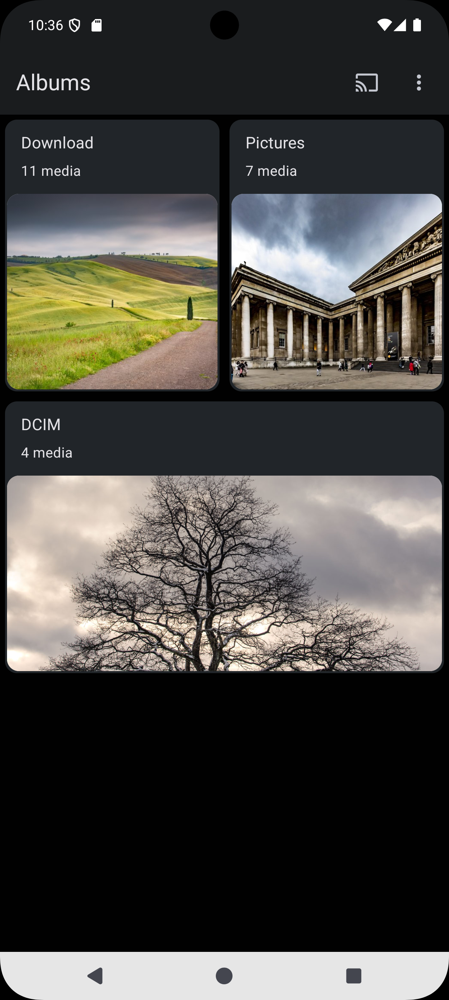
&nbsp;&nbsp;
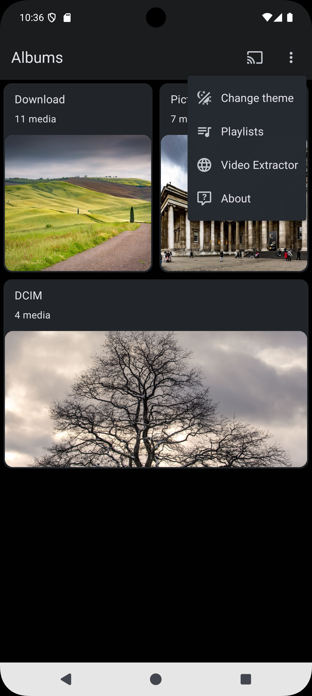
&nbsp;&nbsp;
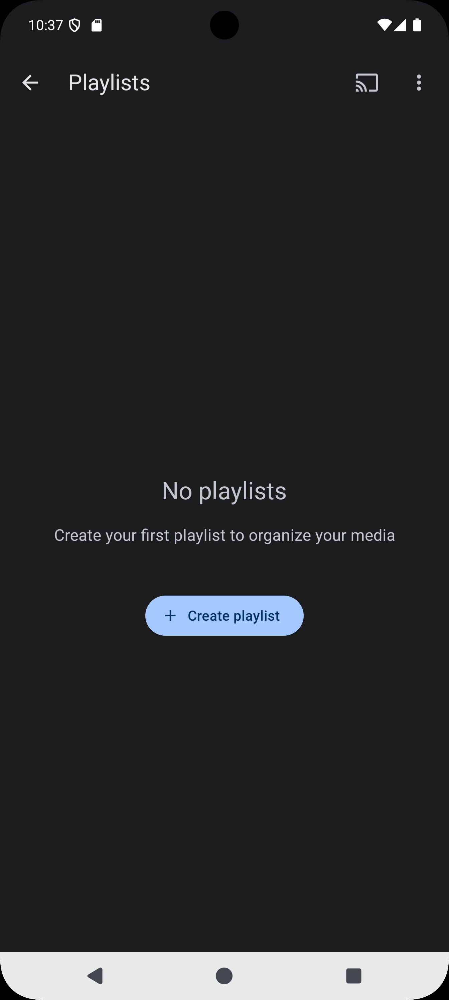
&nbsp;&nbsp;
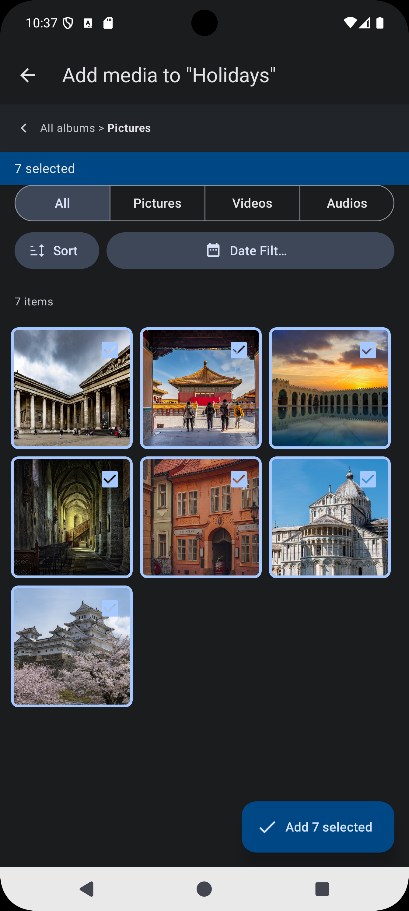
&nbsp;&nbsp;
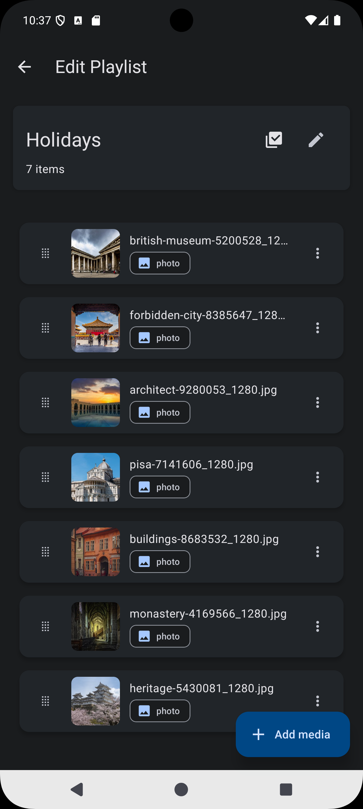
&nbsp;&nbsp;
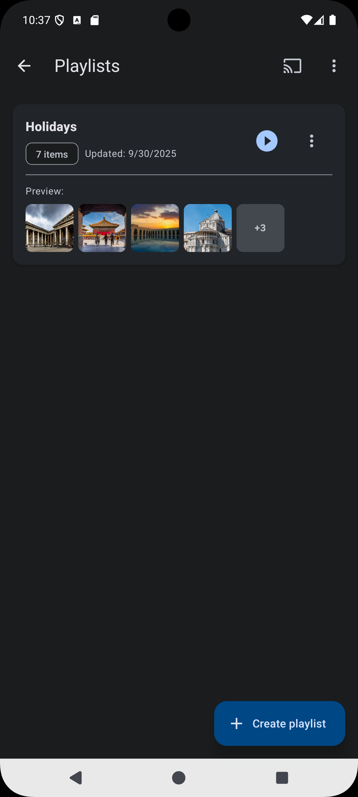
&nbsp;&nbsp;
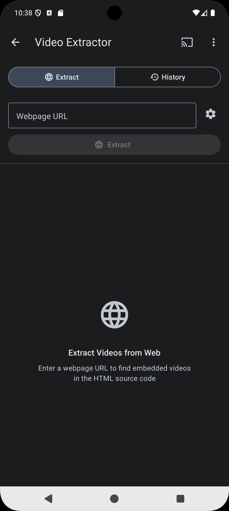

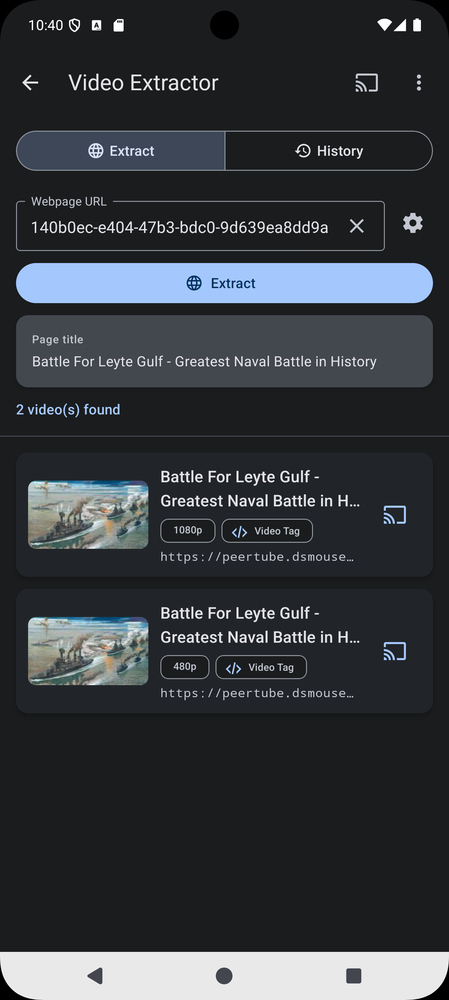
&nbsp;&nbsp;
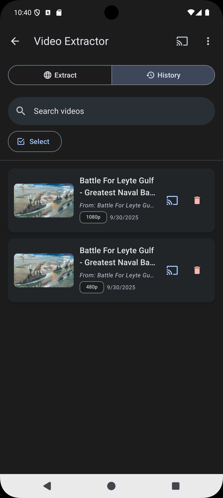
&nbsp;&nbsp;
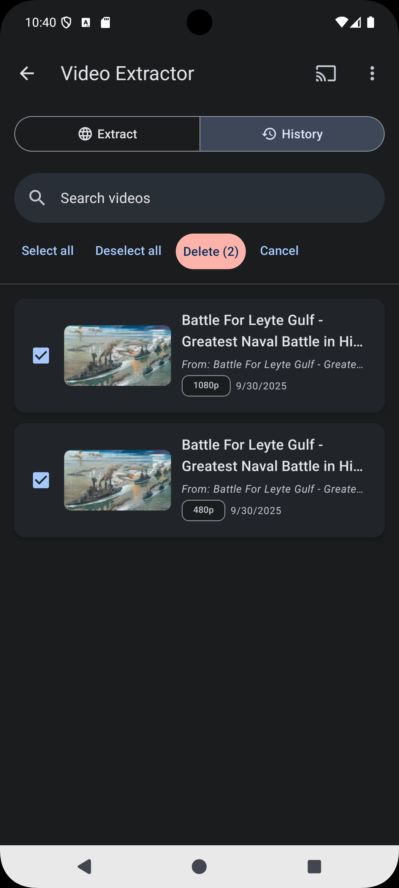
&nbsp;&nbsp;
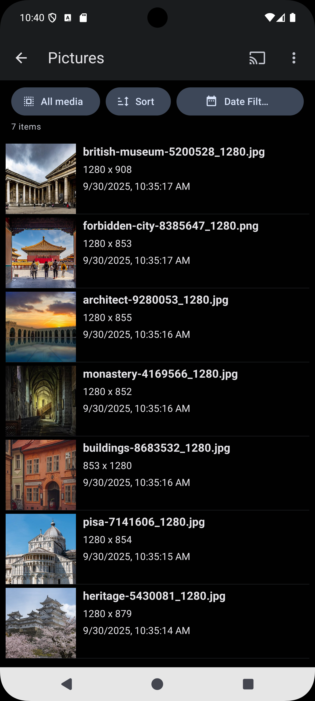
&nbsp;&nbsp;
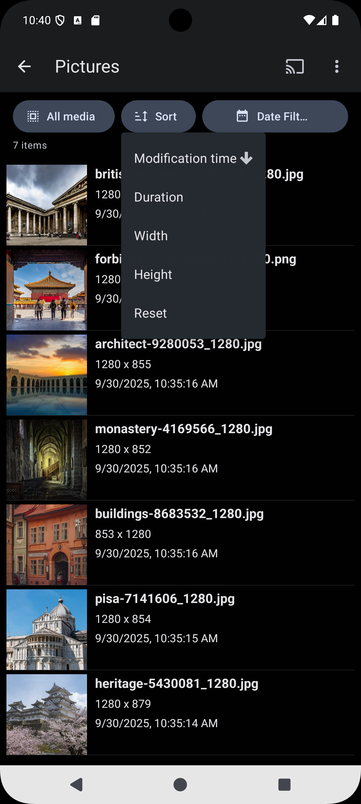
&nbsp;&nbsp;
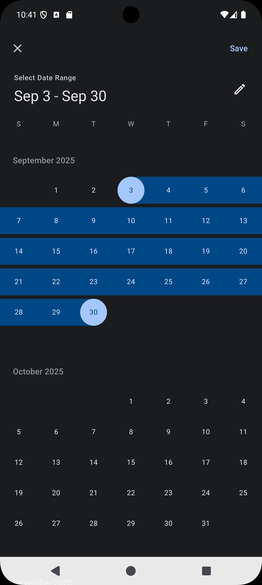
&nbsp;&nbsp;
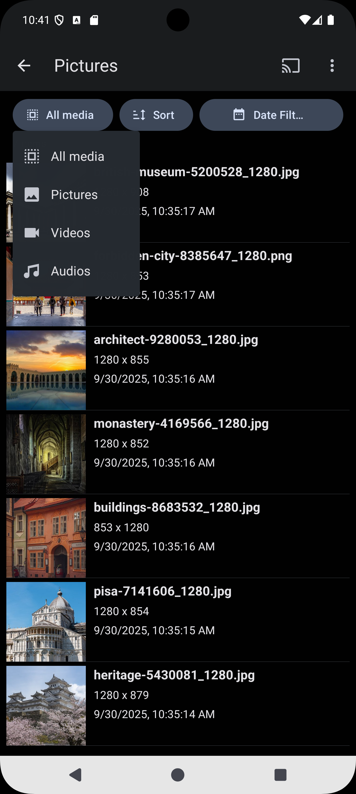

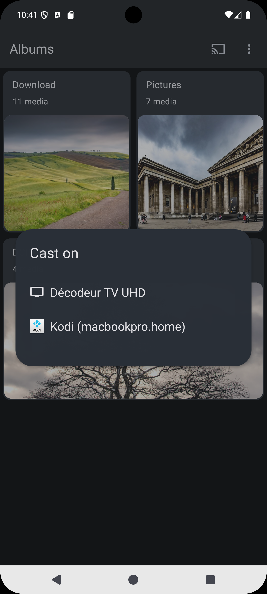
&nbsp;&nbsp;
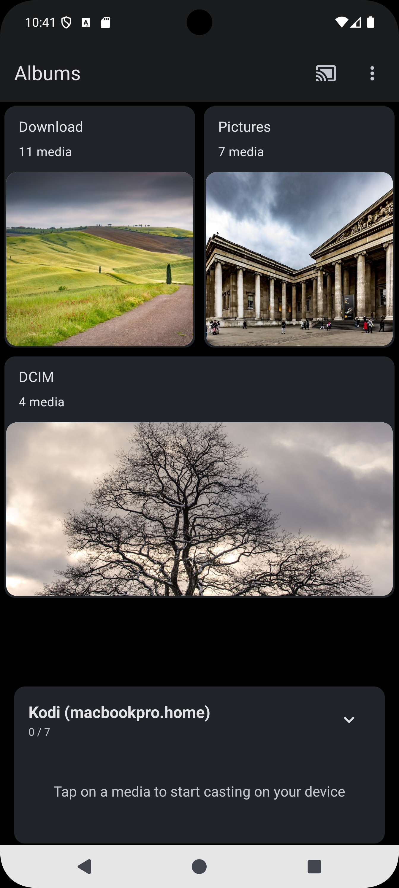
&nbsp;&nbsp;
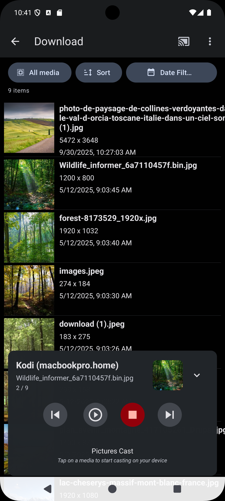
&nbsp;&nbsp;
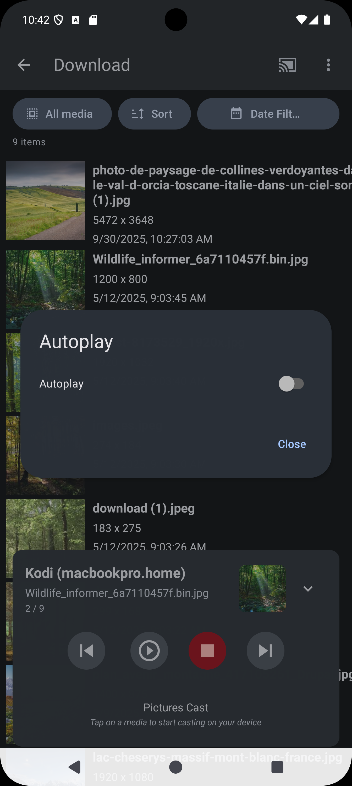
&nbsp;&nbsp;
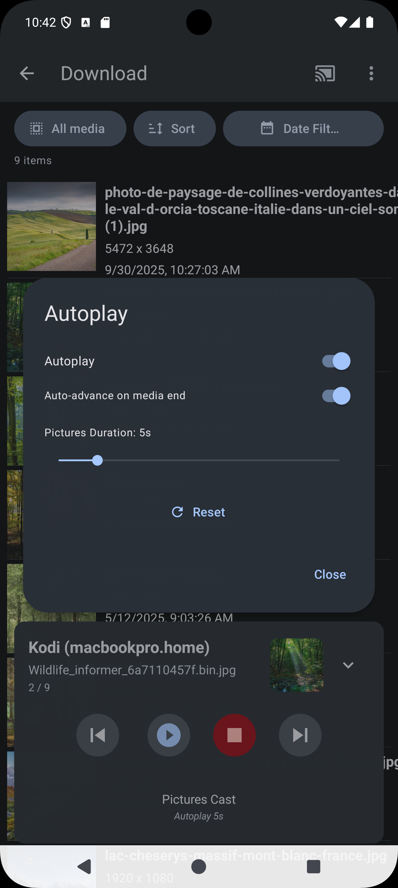
&nbsp;&nbsp;
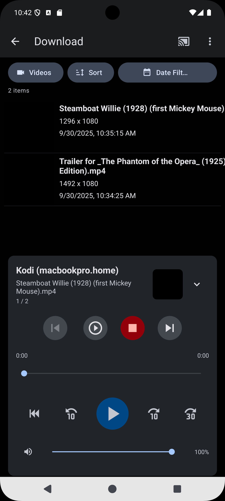

## Build the app

### System requirements:

- [Node.js (LTS)](https://nodejs.org/en/).
- macOS, Windows (Powershell and [WSL 2](https://github.com/expo/fyi/blob/main/wsl.md)), and Linux are supported.

### Clone this repo:

`git clone https://codeberg.org/tom79/CastLab.git CastLab`

### Running the project:

- `cd CastLab`
- `npm install`
- `npx expo prebuild --clean`

#### Via expo

- `npx expo run:android` => Android or `npx expo run:ios` => iOS

#### Android (only)

- `cd android/app`
- `gradle assembleRelease`

